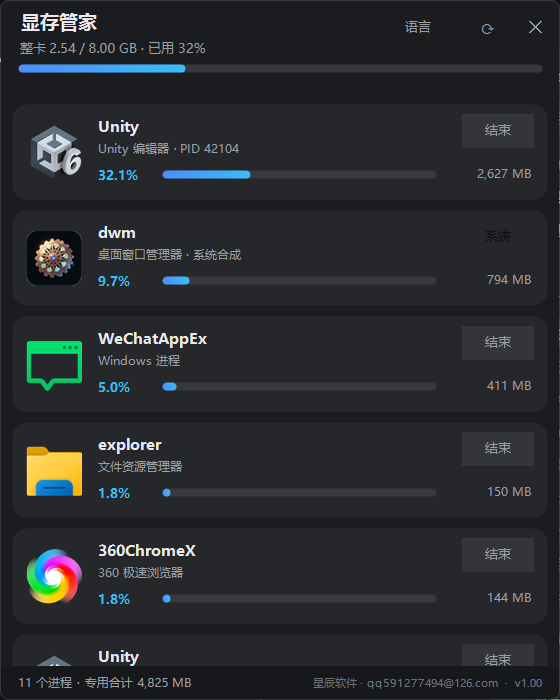
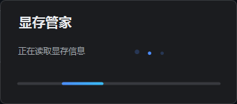
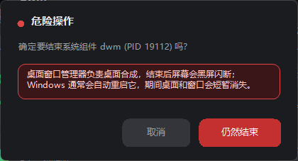

# VRAM Butler (显存管家) v1.00

[English](README.md) | [简体中文](README.zh-CN.md)

A tiny Windows utility that shows per-process video memory usage and releases VRAM held by applications. One single executable, no installer, no network access.



## About

VRAM Butler reads the Windows GPU Process Memory performance counters and lists every process that holds video memory, sorted by dedicated usage. Double-click a card to end the process and reclaim its VRAM immediately. A whole-card usage bar is shown in the header when NVIDIA's `nvidia-smi` is available.

- Source-available and **noncommercial**: free for personal, educational and research use. Commercial use requires a separate license — see [License](#license).
- Author: 星辰软件 (Xingchen Software) · qq591277494@126.com · version 1.00

## Features

- Per-process dedicated and shared VRAM, sorted from high to low
- Whole-card VRAM bar (NVIDIA); graceful fallback when unavailable
- Real large application icons, dark rounded cards, colored usage bars
- Double-click a card to end the process; each card also has an End button
- System components (DWM, CSRSS, WINLOGON, ...) can still be ended, but only after a red warning box that explains the consequences
- Mouse-wheel browsing without any scrollbar
- Modern startup: bouncing-dot loading window, then a smooth fade-in
- Every dialog and tooltip uses the same dark visual style
- No background service, no polling, no registry writes, no telemetry



## Quick start

1. Download [the latest release](https://github.com/panxinlin888/vram-butler/releases/latest) (asset `vram-butler-1.00.exe`; the app itself is named 显存管家), or build it yourself (see below).
2. Double-click it. No runtime installation is required.
3. To end elevated processes, right-click the EXE and choose **Run as administrator**.

Run from source (optional): `pwsh -STA -File 显存查看与释放.ps1`.

## Footprint

- Single executable, about 190 KB including the icon
- No polling while idle; counters are read at launch and when you click ⟳
- No installation, no leftover files, no network connections

## Requirements

- Windows 10 or Windows 11, 64-bit
- Per-process VRAM requires the Windows GPU Process Memory performance counters (WDDM)
- The whole-card bar uses `nvidia-smi` from the NVIDIA driver; other GPUs fall back automatically

## Who it is for

- **AI practitioners**: local LLMs, Stable Diffusion and ComfyUI often leave VRAM held by stale processes
- **Gamers**: see how much VRAM the game, launcher and browser each hold, and clean up stuck processes
- **Streamers, recording and editing users**: find what is consuming VRAM before frame drops appear
- **IT support and PC builders**: locate GPU memory consumers without installing a heavy suite
- **Geeks and developers**: Unity, Chrome, Python and command-line tools in one view
- **Laptop and small-VRAM GPU owners**: give limited VRAM back to the application that needs it

## Usage

- ⟳ — refresh the list and whole-card usage
- ✕ — close the window
- Click a card — select it (outlined)
- Double-click a card — end the process
- Hover a card — full executable path, dedicated memory, shared memory

## Automation (agent-friendly)

Use the headless mode to free VRAM before starting image generation, rendering or local LLM workloads:

```
pwsh 显存查看与释放.ps1 -后台 -目标程序 "msedge,chrome,wechat" -结果文件 vram.json
pwsh 显存查看与释放.ps1 -后台 -目标程序 "msedge,chrome,wechat" -已授权 -结果文件 vram.json
```

- Read-only listing: `-后台 -列表` (no process is ended, ideal for seeing who holds VRAM first)
- Requirement gate: `-需求MB 12000` checks free VRAM after release and reports it in `满足`
- Full parameters, JSON fields and exit codes: see [智能体接口.md](智能体接口.md)
- Without `-已授权` it is a dry run: it lists the matching processes and the VRAM they hold, and ends nothing
- With `-已授权` it ends the matched processes, re-reads the whole-card usage and writes the result
- Targets are exact process names, comma-separated, case-insensitive
- System components, explorer and agent hosts (Qoder, pwsh, node, ...) are always protected, even if listed
- The result file is UTF-8 JSON with mode, matched processes, ended processes, skipped protected names, released dedicated MB, card usage before/after and errors
- `-已授权` is a workflow flag, not a security boundary; the real safety comes from the explicit target list and the built-in protected list

Recommended image-generation sequence:

1. Dry run to see what would be ended and how much VRAM would be released
2. Confirm with the user (or use a pre-authorized target list)
3. Execute, then check the JSON for an empty error list and a lower card usage
4. Start the image-generation application


Ending a standard Windows core component is allowed, but the app shows a red warning box first, for example:



Ending DWM briefly blanks the desktop while Windows restarts it; ending CSRSS, WINLOGON or LSASS can cause an immediate blue screen or logoff. The app never ends these silently — the red button must be clicked explicitly.

## Project

- [Contributing](CONTRIBUTING.md)
- [Security policy](SECURITY.md)
- [Changelog](CHANGELOG.md)
- [Agent interface](智能体接口.md)

## License

**PolyForm Noncommercial License 1.0.0** — see [LICENSE](LICENSE).

- Allowed: personal use, study, research, experimentation, hobby projects, use by noncommercial organizations; modification and redistribution for these purposes
- Not allowed: any commercial use, including use in a commercial product, a paid service, or a for-profit internal workflow
- Commercial licensing: contact **qq591277494@126.com**

This is a source-available, noncommercial project, not OSI open source. Copyright © 2026 星辰软件 (Xingchen Software).

## Build

```
Install-Module ps2exe -Scope CurrentUser
Import-Module ps2exe
Invoke-ps2exe -inputFile 显存查看与释放.ps1 -outputFile 显存管家.exe `
  -iconFile 显存管家.ico -noConsole -STA -x64 -DPIAware `
  -title 显存管家 -description "显存查看与释放 · 星辰软件" `
  -company 星辰软件 -product 显存管家 `
  -copyright "© 2026 星辰软件 · qq591277494@126.com" `
  -version 1.0.0.0
```

The source is a single file with Chinese identifiers, no comments, and only platform API references left in English.

## Packaging notes

- **ps2exe single EXE (used here)**: recommended for this project — tiny, no console, runs on the Windows PowerShell shipped with Windows 10/11
- **Native AOT**: not possible — PowerShell scripts cannot be AOT-compiled, and Windows Forms is not supported by Native AOT
- **C# MAUI**: not suitable — this is a Windows-only tool using performance counters, shell icons and DWM; MAUI adds size and complexity for no benefit
- **C# WinForms rewrite**: optional — faster startup and lower memory; framework-dependent single file is a few hundred KB, self-contained about 150 MB
