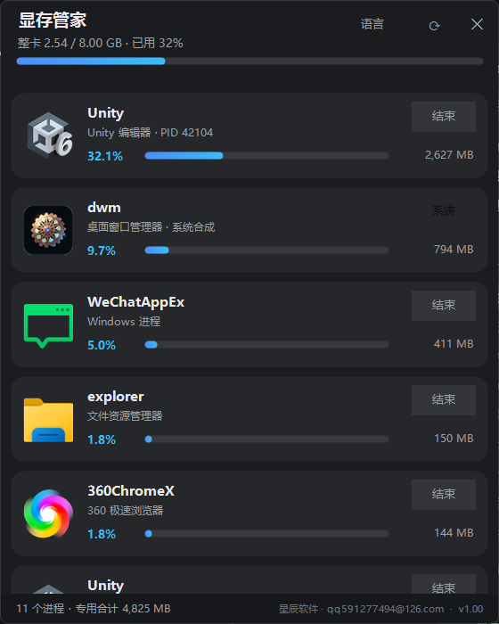
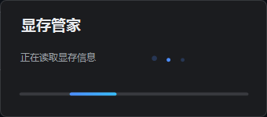
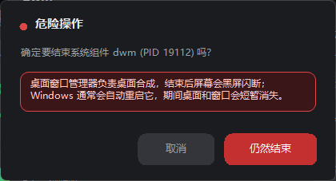

# 显存管家 v1.00

[English](README.md) | [简体中文](README.zh-CN.md)

一款 Windows 桌面小工具：逐进程查看显存占用，并随时释放被应用占用的显存。单文件、绿色运行、无安装、无网络请求。



## 关于

显存管家读取 Windows 的 GPU Process Memory 性能计数器，按专用显存从高到低列出所有占用显存的进程。双击卡片即可结束进程并立即回收显存。顶部在 NVIDIA 驱动可用时显示整卡占用进度条。

- 源码公开、**非商业**：个人、教育、研究免费使用；商业使用需要单独授权，见[许可证](#许可证)
- 作者：星辰软件 · qq591277494@126.com · 版本 1.00

## 功能

- 逐进程读取专用显存与共享显存，按占用从高到低排列
- 顶部整卡显存进度条（NVIDIA 可用时）；读取不到自动降级为“专用合计”
- 真实应用大图标、深色圆角卡片、彩色占用进度条
- 双击卡片结束进程；每张卡片也有“结束”按钮
- 系统核心组件（DWM、CSRSS、WINLOGON 等）允许结束，但必须先看到红框后果说明
- 滚轮浏览列表，没有滚动条
- 现代启动体验：三点跳动的加载窗，加载完成后淡入主界面
- 所有弹窗、提示、按钮同一套深色风格
- 无后台常驻、无定时轮询、不写注册表、不联网



## 快速启动

1. 下载 [最新版本](https://github.com/panxinlin888/vram-butler/releases/latest)（`显存管家.exe`），或按下方说明自行构建
2. 双击即可运行，无需安装任何运行库
3. 要结束以管理员权限运行的程序，右键 EXE → 以管理员身份运行

用源码运行（可选）：`pwsh -STA -File 显存查看与释放.ps1`

## 体积与占用

- 单文件约 190 KB（含图标）
- 空闲时不刷新、不轮询、不占显卡；只在启动和点击 ⟳ 时读取一次
- 无安装、无残留文件、无任何网络连接

## 系统要求

- Windows 10 / Windows 11，64 位
- 逐进程显存依赖 Windows 的 GPU Process Memory 性能计数器（WDDM）
- 顶部整卡进度条依赖 NVIDIA 驱动自带的 nvidia-smi；其他显卡会自动降级显示

## 适用人群

- **AI 产业相关人群**：本地运行大模型、Stable Diffusion、ComfyUI，显存被残留进程占用时一眼定位
- **游戏玩家**：查看游戏、启动器、浏览器各自占用的显存，处理卡死或后台残留进程
- **主播、录屏与剪辑用户**：确认显存被哪个软件占用，避免直播或渲染掉帧
- **IT 运维与装机人员**：无需安装大型工具即可快速定位 GPU 占用来源
- **各类极客与开发者**：Unity、Chrome、Python、命令行工具一屏看清
- **小显存笔记本与老旧显卡用户**：把有限的显存让给真正需要的程序

## 使用说明

- ⟳：立即刷新进程列表与整卡占用
- ✕：关闭窗口
- 单击卡片：选中并描边
- 双击卡片：结束该进程
- 悬停卡片：显示程序完整路径、专用显存、共享显存

## 自动化（智能体调用）

在启动生图、渲染或大模型任务前，先用无人值守模式腾出显存：

```
pwsh 显存查看与释放.ps1 -后台 -目标程序 "msedge,chrome,wechat" -结果文件 vram.json
pwsh 显存查看与释放.ps1 -后台 -目标程序 "msedge,chrome,wechat" -已授权 -结果文件 vram.json
```

- 只读清单：`-后台 -列表`，不会结束任何进程，适合先看谁占着显存
- 显存需求闸门：`-需求MB 12000`，执行后检查整卡空闲显存是否达标，JSON 里有 `满足` 字段
- 完整参数、JSON 字段与退出码见 [智能体接口.md](智能体接口.md)
- 不带 `-已授权` 是预演：只读取并列出命中进程与预计释放的显存，不结束任何进程
- 带 `-已授权` 才真正结束目标进程；结束后重新读取整卡占用并写入结果
- 目标进程按名称精确匹配（逗号分隔，不区分大小写）
- 系统核心组件、explorer、以及智能体宿主（Qoder、pwsh、node 等）始终受保护，即使写进目标列表也不会被结束
- 结果文件是 UTF-8 JSON，含 模式、命中进程、已结束、跳过保护、释放专用MB、整卡前MB、整卡后MB、错误
- `-已授权` 是流程开关，不是安全边界；真正的安全来自“显式目标列表 + 内置保护列表”

生图流程建议顺序：

1. 预演，拿到将结束的进程与释放量
2. 向用户确认（或使用预先授权的目标列表）
3. 执行，读取 JSON 确认 错误 为空、整卡占用已下降
4. 启动生图程序


结束标准 Windows 核心组件是允许的，但会先弹出红框警告，例如：



结束 DWM 会让桌面黑屏闪断，Windows 通常会自行重启它；结束 CSRSS、WINLOGON、LSASS 等可能导致立即蓝屏或注销。程序不会静默结束任何系统组件，必须明确点击红色按钮。

## 项目

- [参与贡献](CONTRIBUTING.md)
- [安全策略](SECURITY.md)
- [更新日志](CHANGELOG.md)
- [智能体接口](智能体接口.md)

## 许可证

**PolyForm Noncommercial License 1.0.0**，详见 [LICENSE](LICENSE)。

- 允许：个人使用、学习、研究、实验、业余项目、非商业组织使用；用于这些目的的修改与分发
- 不允许：任何商业用途，包括商业产品内置、付费服务、以营利为目的的内部流程
- 商业授权：联系 **qq591277494@126.com**

本项目是源码公开的非商业项目，不是 OSI 定义的开源软件。版权所有 © 2026 星辰软件。

## 构建

```
Install-Module ps2exe -Scope CurrentUser
Import-Module ps2exe
Invoke-ps2exe -inputFile 显存查看与释放.ps1 -outputFile 显存管家.exe `
  -iconFile 显存管家.ico -noConsole -STA -x64 -DPIAware `
  -title 显存管家 -description "显存查看与释放 · 星辰软件" `
  -company 星辰软件 -product 显存管家 `
  -copyright "© 2026 星辰软件 · qq591277494@126.com" `
  -version 1.0.0.0
```

源码为单文件，方法、类、变量全部中文命名，除系统接口引用外无英文标识符，无任何注释。

## 发布方式说明

- **ps2exe 单文件（当前采用）**：推荐。体积小、无控制台、Win10/11 自带 PowerShell 即可运行
- **Native AOT**：不可行。PowerShell 脚本无法 AOT；即使改写成 C# WinForms，官方也不支持 Native AOT
- **C# MAUI**：不推荐。本工具是 Windows 专用，依赖性能计数器、shell 图标与 DWM，MAUI 只会增大体积和复杂度
- **C# WinForms 重写**：可选。启动更快、内存更低；框架依赖单文件约数百 KB，自包含约 150 MB
